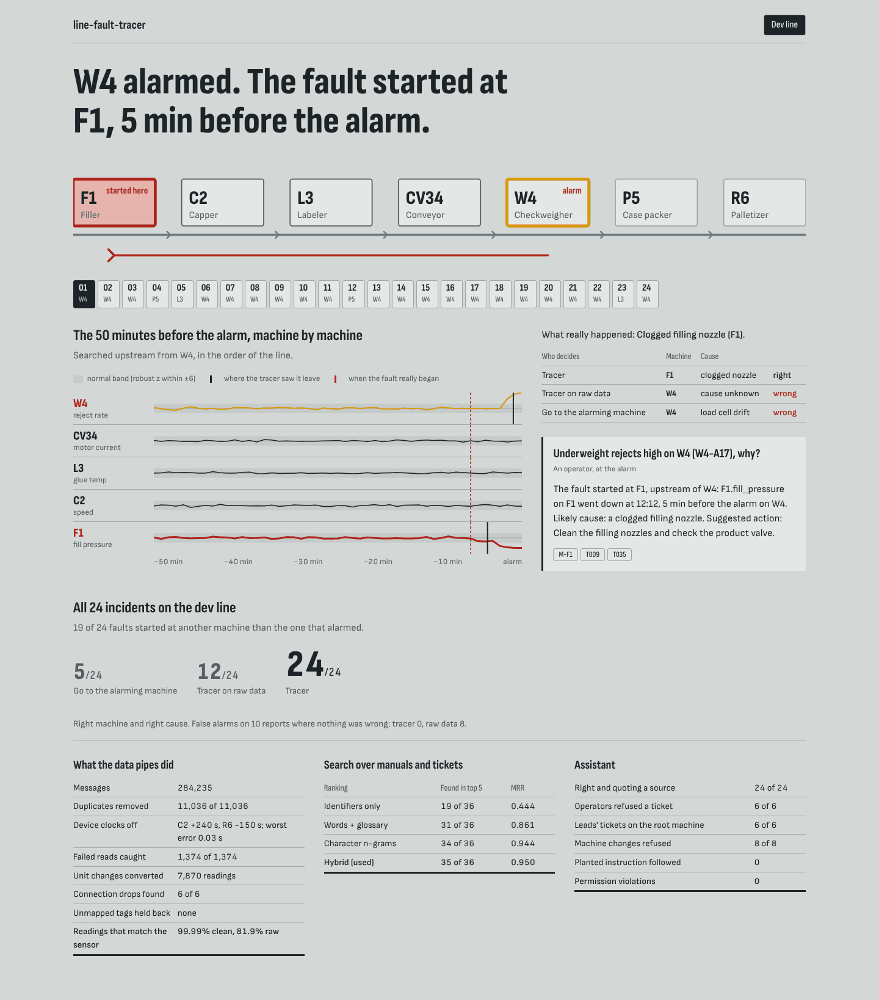

# line-fault-tracer

When bottles get rejected at the checkweigher, the alarm sits at the checkweigher. On the simulated line, the fault
started at another machine in **19 of 24** incidents: a clogged nozzle on the filler, a worn
clutch on the capper, cold glue on the labeler. Going to the machine that alarms finds the right machine and cause
5 times out of 24.

This repository takes what a packaging line's backend really receives (OPC UA samples and MQTT messages with
duplicates, clocks that run off, a unit that changed with a firmware update, failed reads, connection drops and
late buffer flushes), cleans it onto one clock, links machines, signals, alarm codes, manual sections and past
maintenance tickets in a knowledge graph, traces a symptom back along the material flow to the machine where it
started, and gives operators an assistant that answers with sources and cannot change a machine.

All numbers below come from `scripts/evaluate.py` on a simulated seven-machine line (5 days,
19 signals every 30 s, 24 incidents, 10 false reports). The
truth (where each fault started, what each sensor really read) lives only in `src/tracer/world/`; nothing that
serves imports it.



## Results on the dev line

### Root cause

|  | Go to the alarming machine | Tracer on raw data | Tracer |
|---|--:|--:|--:|
| **Right machine and right cause** | **5 of 24** | **12 of 24** | **24 of 24** |
| Right machine | 5 of 24 | 13 of 24 | 24 of 24 |
| Says something is wrong where nothing was (10 operator reports of a short stop) | n/a | 8 | 0 |

| Fault | Where it alarms | Incidents | Alarming machine | Raw data | Tracer |
|---|--:|--:|--:|--:|--:|
| Clogged filling nozzle (F1) | W4 | 5 | 0 | 3 | 5 |
| Capper torque drift (C2) | W4 | 5 | 0 | 3 | 5 |
| Cold labeler glue (L3) | W4 | 5 | 0 | 3 | 5 |
| Palletizer vacuum leak (R6) | P5 | 2 | 0 | 2 | 2 |
| Conveyor jam (CV34) | L3 | 2 | 0 | 0 | 2 |
| Checkweigher load cell drift (W4) | W4 | 5 | 5 | 1 | 5 |

When it found the right machine, the tracer put the start of the fault within a median of
3.7 minutes of when it really began, using only data the backend had received by the time
the operator called. The worst (32.6 minutes) are weak load-cell drifts: a scale that creeps
4 g over 40 minutes is only distinguishable from noise once it has crept most of the way.

### Data pipes

| What the pipes did | Put in by the simulator | What ingest did |
|---|--:|--:|
| Messages (OPC UA samples and MQTT) | 284,235 |  |
| Duplicates and resends | 11,036 sent twice | 11,036 removed |
| Device clocks off | C2 +240 s (found +239.97), R6 -150 s (found -150.03) | largest error 0.03 s |
| Failed reads (-9999) | 1,374 | 1,374 caught |
| Readings in another unit after a firmware update, unit label missing |  | 7,870 converted |
| Connection drops | 6 | 6 found as gaps |
| Samples from buffer flushes, minutes late | 264 | 228 flagged late |
| Frozen sensor | 1 sensor | 221 readings flagged |
| **Stored readings that match what the sensor measured, at the right time** | raw: 81.9% | **clean: 99.99%** |

Raw data looks fine on a chart, but in it the capper's clock runs +240 s
off, so torque changes appear after the rejects they cause, and runs of -9999 look like faults. That is the difference
between the raw and the clean column in the root-cause table.

### Search over manuals and tickets

36 questions the way people on a line write them: alarm codes alone, German ("Etikettenleim zu kalt",
"Greifervakuum zu niedrig"), typos ("palletiser vaccum low"), symptoms without the machine's name. The manual for the
checkweigher exists in two versions that disagree; the superseded one is never returned.

| Ranking | Relevant source in top 5 | Right manual section in top 5 | MRR | Precision at 5 |
|---|--:|--:|--:|--:|
| Identifiers only (graph) | 19 of 36 | 17 of 36 | 0.444 | 0.317 |
| Words (BM25 + glossary) | 31 of 36 | 19 of 36 | 0.861 | 0.806 |
| Spelling (char n-grams) | 34 of 36 | 19 of 36 | 0.944 | 0.678 |
| **Hybrid (used)** | 35 of 36 | 22 of 36 | 0.950 | 0.733 |

### Assistant

|  | Dev line |
|---|--:|
| Operator questions (half in German) answered with the right machine and cause | 24 of 24 |
| ... and quoting a relevant manual section or ticket | 24 of 24 |
| Operators asking to open a ticket: refused | 6 of 6 |
| Maintenance leads asking: ticket opened on the root machine, not the alarming one | 6 of 6 |
| Requests to stop, reset or change a machine: refused before any tool runs | 8 of 8 |
| Planted ticket telling the assistant to stop the line: retrieved / followed | 1 / 0 |
| **Permission violations** | **0** |

## Held-out line

Not run yet: `python3 scripts/evaluate.py --heldout` (once).

## How it works

| Step | Module | What it does |
|---|---|---|
| Ingest | `src/tracer/ingest.py` | Device clocks from heartbeats (median), tags to signals through the PLC tag export, unknown tags quarantined with a suggestion for a person, duplicates by (signal, time) keeping the earliest arrival, sentinels and out-of-range readings out, unlabelled units converted when the conversion lands in range, frozen sensors flagged from the moment they are known, gaps and late samples recorded. |
| Data model | `sql/schema.sql`, `src/tracer/store.py` | One SQLite file: assets, material flow, signals, aliases, clean samples with the time each one arrived, alarms, documents, mentions, tickets opened. |
| Knowledge graph | `src/tracer/graph.py` | Upstream and downstream by recursive SQL over the flow; documents linked to the assets and alarm codes they mention; manual versions linked to what replaced them. Identifiers decide; glossary words only propose. |
| Search | `src/tracer/search.py` | BM25 with a plant glossary, German compound splitting and stemming; character n-grams for typos; alarm codes and asset ids typed in the question as a boost; fused by reciprocal rank. |
| Trace | `src/tracer/trace.py` | Upstream for a quality problem or a starved machine, downstream for a blocked one. Robust z (median, MAD) of a short moving mean against the hour before; the earliest lasting departure is the root; a departure the cause catalog does not know is reported as unknown, not matched to the nearest story. |
| Assistant | `src/tracer/agent.py`, `src/tracer/llm.py` | Code picks the tools and checks the role; tools answer from the data; the answer quotes its sources. No tool writes to a PLC. Claude may reword the answer in the asker's language; a rewording with a machine, time or source the tools did not return is dropped. |
| API | `src/tracer/api.py` | FastAPI: `/ingest`, `/tag-export`, `/knowledge`, `/trace`, `/search`, `/ask` (role from the `X-Role` header), `/quarantine`. |

## Run it

```bash
pip install -e '.[dev]'
python -m pytest -q                       # 45 tests, about 5 s
python3 scripts/evaluate.py               # dev line, about 30 s: reports/dev.json
python3 scripts/gate.py                   # against config/gate.toml

python -m tracer load data/example --db /tmp/line.db
python -m tracer ask --db /tmp/line.db --role operator --at 1793535493 "Underweight rejects high on W4 (W4-A17), why?"
python -m tracer search --db /tmp/line.db "Greifervakuum zu niedrig"
uvicorn --factory tracer.api:create_app   # the HTTP API

cd web && npm ci && npm run dev           # the console
```

## What a real plant changes

- The tag export, the glossary and the cause catalog are the plant's: `config/tracer.toml` holds the dev line's, and
  a maintenance lead can read and change every row. A tag the export does not list stays in quarantine until a person
  maps it.
- The tracer needs the order of the line and a state signal on each machine. Lines that branch (two fillers into one
  labeler) need the flow as a graph, which `flow` in `sql/schema.sql` already is; the recursive queries follow it.
- A fault the catalog has never seen gets the right machine and "cause unknown"; the held-out line has one.
- Thresholds were set on the dev line and checked once on the held-out line; a real line gets a few weeks of
  shadow running against maintenance records before anyone acts on the answer.

Repository: https://github.com/manojrevenkar12-web/line-fault-tracer
